<p align="center">
  
</p>

<p align="center">
  
  
  
  <a href="https://github.com/harmflow/harmflow-app/actions/workflows/ci.yml"></a>
  <a href="LICENSE"></a>
</p>

<p align="center">
  
  
  
  
</p>

<p align="center">
  <b>The engine room of HarmFlow.</b><br>
  The daemon that schedules and runs tasks on the agent harnesses already on your machine — Claude Code and Codex —<br>
  the desktop that follows every execution, and the installers that ship them.
</p>

<p align="center">
  <a href="#architecture">Architecture</a> ·
  <a href="#layout">Layout</a> ·
  <a href="#quick-start">Quick start</a> ·
  <a href="#commands">Commands</a> ·
  <a href="#a-task-is-a-file">Tasks</a> ·
  <a href="#how-a-task-runs">How a task runs</a>
</p>

> [!IMPORTANT]
> **MVP in progress, macOS first.** Nothing here is a signed release: until the Developer ID exists, builds are
> unsigned and Gatekeeper asks for confirmation on first open. Specifications, ADRs, and architecture live in a
> private repository.

## Architecture

<p align="center">
  
</p>

## Layout

<table>
  <tr>
    <td width="33%" valign="top">
      <code>01</code> <a href="contracts"><b>contracts/</b></a><br>
      The local API (<code>api/openapi.yaml</code>) and the JSON Schemas of tasks, events, and execution reports —
      the single source of truth for every name.
    </td>
    <td width="33%" valign="top">
      <code>02</code> <a href="daemon"><b>daemon/</b></a><br>
      <code>harmflowd</code>, in Go: domain, use cases, ports, and adapters — Claude Code, Codex, YAML files, JSON
      state, JSONL events, HTTP + SSE, Keychain, launchd.
    </td>
    <td width="33%" valign="top">
      <code>03</code> <a href="desktop"><b>desktop/</b></a><br>
      The desktop shell: <code>src-tauri</code> (Tauri 2, Rust — tray, notifications, the daemon connection) and
      <code>ui</code> (React, TypeScript).
    </td>
  </tr>
  <tr>
    <td width="33%" valign="top">
      <code>04</code> <a href="agents"><b>agents/</b></a> · <a href="skills"><b>skills/</b></a><br>
      The built-in agent and skills of the issue implementer, which a new GitHub task selects by default, prefixed
      <code>hf-</code>.
    </td>
    <td width="33%" valign="top">
      <code>05</code> <a href="packaging"><b>packaging/</b></a><br>
      What Tauri's bundle does not cover: signing and per-OS packaging notes.
    </td>
    <td width="33%" valign="top">
      <code>06</code> <a href="tests"><b>tests/</b></a><br>
      Tests across parts: the real daemon binary driven over its API, with stand-in harness CLIs.
    </td>
  </tr>
</table>

## Quick start

| You need | Version | For |
|---|---|---|
| Go | 1.24 | the daemon |
| Node with pnpm | 26 · 10 | the interface |
| Rust | stable | the desktop shell |
| Claude Code or Codex | signed in | running tasks |
| Git and the GitHub CLI (`gh`) | signed in | the GitHub task type |
| `rsvg-convert` (`brew install librsvg`) | any | `make icons` only — the rendered icons are committed |
| `cargo-llvm-cov`, with Rust's `llvm-tools-preview`, and `jq` | any | `make coverage` only |

HarmFlow never installs or updates any of them. It signs Claude Code in again only through its own `/login`, which you
approve in the browser, or with a long-lived token you save in Settings. With those in place:

```bash
make deps          # once: the desktop's JavaScript dependencies
make dev-daemon    # the daemon, on .harmflow-dev/home
make dev-ui        # in a second terminal: the interface at http://localhost:1420
```

Dependabot proposes monthly updates to the Go, pnpm, and Cargo dependencies and to the CI actions; a major update comes
in its own pull request and is reviewed on its own.

This repository's CI checks Linux only, for the code as it is published here; every other platform is built and
checked outside this repository. Development stays on macOS. A test that needs another platform skips on Linux and
says why, as [`docs/go-code-guide.md`](docs/go-code-guide.md) describes under "Tests by platform". The workflows, the scripts they
run, and the Dependabot groups are described in [`docs/ci.md`](docs/ci.md).

## Commands

| Command | What it does |
|---|---|
| `make help` | List every target |
| `make deps` | Install the desktop's JavaScript dependencies |
| `make test` | Run the daemon, desktop, and integration tests |
| `make coverage` | Read the tests' coverage of the daemon, the interface, and the shell, and fail below a floor; the floors and their reading are in [`docs/coverage.md`](docs/coverage.md) |
| `make dev-daemon` | Run the daemon on `.harmflow-dev/home` |
| `make dev-ui` | Serve the interface in a browser, proxied to that daemon (`http://localhost:1420`) |
| `make dev-desktop` | Run the desktop shell against that daemon |
| `make generate` | Refresh the copies generated from `contracts/`; `make check-generated` fails when one is stale |
| `make app` | Build `HarmFlow.app` and the DMG, unsigned |
| `make update-app` | On `main`, fast-forward, run `make app` unless the build is already of that commit (`FORCE_BUILD=1` builds anyway), and install the build to `~/Applications/HarmFlow.app` (`INSTALL_DIR` changes the directory), then restart from it the daemon and the window that were running; `OPEN=1` starts them also when they did not run. Refused while executions run; `WAIT=1` waits for them to end instead (see [`packaging/`](packaging/README.md#updating-the-local-app)) |
| `make test-packaging` | Test `make update-app`'s launch-agent check, install, build skip, and wait, on the Mac: CI runs on Linux and leaves it out |
| `make icons` | Render every app and tray icon from the SVGs in `desktop/src-tauri/icons/source` |

Three environment variables change where the daemon keeps its data and its token:

| Variable | Default | Effect |
|---|---|---|
| `HARMFLOW_HOME` | `~/Library/Application Support/HarmFlow` | The data directory |
| `HARMFLOW_TOKEN_STORE` | the Keychain | `file` keeps the local API token in a user-only file instead |
| `HARMFLOW_KEYCHAIN` | the default keychain | The keychain file that holds the token, for tests; the desktop reads the token from it too |

## Running the local app

Run the installed copy, `~/Applications/HarmFlow.app`, which `make update-app` builds from `main` and replaces.
`make update-app` registers that copy with Launch Services and unregisters the bundles of this checkout's Cargo output
and those whose path is gone, so launching HarmFlow by name opens it
([`packaging/`](packaging/README.md#launching-by-name)). Cargo writes to `desktop/src-tauri/target.noindex`
(`.cargo/config.toml`), which Spotlight does not index. A `desktop/src-tauri/target` left from before that is indexed,
and its bundles keep coming back: delete it.

A build started from another path, such as a worktree's `target.noindex/release`, is another copy with the same data
directory: its window attaches to whichever daemon `run/daemon.json` names, and a daemon it starts serves the installed
app's tasks and executions too. Give such a build a data directory of its own with `HARMFLOW_HOME`, or use
`make dev-desktop`, which runs on `.harmflow-dev/home`.

## A task is a file

One YAML file per task, in the data directory's `tasks/`, validated by
[`contracts/schemas/task.schema.json`](contracts/schemas/task.schema.json):

```yaml
apiVersion: harmflow/v1alpha1
kind: Task
metadata:
  id: nightly-issues
  name: Implement ready issues
spec:
  type: github                                # works GitHub repositories; or general, or script
  prompt: |                                   # the agent hf-github-issue-implementer, copied and customized
    You implement GitHub issues for a HarmFlow task, unattended. …

    ## This task

    - **Eligible issues:** open issues labeled `ready-for-agent`.
    - **Work branch:** `harmflow/<issue-number>-<short-slug>`.
    - …
  skills: [hf-github-issue-queue, hf-github-worktree, hf-github-draft-pr]
  schedule:
    cron: "0 2 * * 1-5"                       # weeknights at 02:00
    missedRun: {policy: run_on_resume}        # asleep at 02:00? run on wake
  harness:
    preferred: {provider: claude-code}
    fallback:
      candidates: [{provider: codex}]         # quota exhausted or unavailable → Codex
  permissions: {profile: workspace_write, network: allow}
  github:                                     # the repositories it works, and its per-cycle limits
    repositories:
      - {name: acme/api, localPath: ~/code/acme/api}
```

A GitHub task does in its repositories what its prompt, agents, and skills say: this one implements issues with the
built-in issue implementer, which never merges. A file that still names the type `github-issue-implementation` and its
block `githubIssueImplementation` loads as before, and saving it writes the new names.

A repository's `baseBranch` is `main` unless it names another, and any branch is accepted. GitHub links a pull
request's `Closes #<n>` to its issue only when the pull request goes into the repository's default branch. With
another base branch, the built-in skills find a pull request's issue by the number its work branch carries, 42 in
`harmflow/42-retry-limit`, and GitHub does not close the issue when the pull request merges: the issue is closed by
hand, or when that branch reaches the default one.

## How a task runs

<table>
  <tr>
    <td width="33%" valign="top">
      <code>01</code> <b>Fire</b><br>
      On its cron or interval, on wake for a run the machine slept through, or by hand.
    </td>
    <td width="33%" valign="top">
      <code>02</code> <b>Start</b><br>
      The daemon starts the task's harness non-interactively, with the task's prompt, agents, and skills, in a
      workspace.
    </td>
    <td width="33%" valign="top">
      <code>03</code> <b>Govern</b><br>
      The task's permission profile is translated to the harness's own controls; one it cannot enforce runs with a
      warning.
    </td>
  </tr>
  <tr>
    <td width="33%" valign="top">
      <code>04</code> <b>Report</b><br>
      The session leaves progress lines and a report in its execution directory, under <code>runs/</code>.
    </td>
    <td width="33%" valign="top">
      <code>05</code> <b>Stream</b><br>
      The daemon records them and streams every event to the dashboard over SSE.
    </td>
    <td width="33%" valign="top">
      <code>06</code> <b>Fail over &amp; notify</b><br>
      An exhausted quota or an unavailable harness moves the task to the next harness. Then the daemon notifies.
    </td>
  </tr>
</table>

HarmFlow itself implements no task behavior: the harness, its agents, and its skills do the work.

## Part of HarmFlow

- **Product overview** — the [HarmFlow organization](https://github.com/harmflow) page.
- **Website** — [`harmflow-site`](https://github.com/harmflow/harmflow-site).
- **Ask or report a bug** — [open an issue](https://github.com/harmflow/harmflow-app/issues) here; a vulnerability
  goes privately through the [security policy](https://github.com/harmflow/.github/blob/main/SECURITY.md), never in
  a public issue.
- **Contribute** — pull requests are open to authorized collaborators only for now; see the
  [contribution guide](https://github.com/harmflow/.github/blob/main/CONTRIBUTING.md).

<p align="center"><sub>Automate the repetitive. Amplify what matters.</sub></p>
